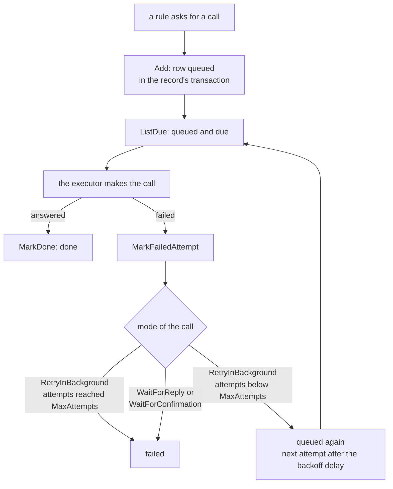

> Read AGENTS.md at the repo root before any change.
> **Finish by yourself:** when the delivery check passes, commit, push and open the pull request. Never ask whether to
> proceed or finalize — nobody answers, and a session that waits ends without your work. Commit after every stage.
> Never run `git reset`, `git restore`, `git checkout -- <file>` or `git stash` on your own work.
> A PR that does not compile, or whose tests could not run, is a failed delivery. Stuck for 30 minutes: open the PR anyway and list what fails.
> Never edit `definition_gen.go`. Never write `go.mod`/`go.sum` lines by hand: only `go get` and `go mod tidy` do. Do not commit scratch files.

# Plan: `externalcalls`, first slice (the queue)

Decisions D36, D45 and D58 of the architecture master: a rule decides which external calls it wants; the calls are stored **in the same transaction as the record**, run later by an executor, and end `done` or `failed`. This first slice is **only the queue and its state machine**. It does not make calls, does not sleep, does not read a clock, does not open a transaction and does not import `crud`: the caller injects the transaction (`Creator`), the clock and the ids. The executor that makes the calls, `crud.ApplyAndPublish(calls...)` and `appkit` come in later plans, after this tag.

## Ecosystem search

Searched `ls ~/Dev/Project/webtyp`, `grep -rli 'outbox\|queued\|retry' --include=*.go`, and `docs/EXTERNAL_CALLS_DRAFT.md`.

| Where | What it does | Decision |
|---|---|---|
| `webtyp.com/outbox` | browser queue of mutations; writes through its own `*orm.DB`, outside the transaction `crud` opens | **not reusable** (D36): the whole point here is the same-transaction write |
| `webtyp.com/backoff` `v0.1.0` | delay after N failures | **reuse** for the retry delay |
| `webtyp.com/model` `v0.2.19` | `ExternalCallDefinition`, `ExternalCallMode`, `Validate()` | **reuse**: the mode and limits of a call are declared there |
| `webtyp.com/idempotency` | server side of the `Idempotency-Key` header (inbound requests) | not related |

Everything else is **new**: no repo stores calls to other systems.

## Design gate

**1. Prior art** (links **unverified**, not read in this session): the transactional outbox pattern (https://microservices.io/patterns/data/transactional-outbox.html); Stripe idempotent requests (https://docs.stripe.com/api/idempotent_requests); Temporal activity retry policy (https://docs.temporal.io/encyclopedia/retry-policies). They share: the intent to call is stored atomically with the data, a call carries a stable key, retries are bounded and visible. This library follows that and **departs** in one point: a call that waits for a reply (`WaitForReply`) or for a confirmation (`WaitForConfirmation`) is never retried in the background, because the declaration carries no attempt limit for them and a hidden default is forbidden.

**2. Novice-name test.** `Queue`, `Add`, `ListDue`, `MarkDone`, `MarkFailedAttempt`, `QueuedCall`, `Request`, `Creator` read as sentences: «add a request to the queue», «list the due calls», «mark a call done». States are `queued`, `done`, `failed`.

**3. Complexity ledger.**
```
Concepts the developer must learn   +5 (Queue, Request, QueuedCall, State, Creator)
Files they must touch to do X       +0 (a rule returns the calls; crud calls Add in a later plan)
Lines at the call site              +1
Ways to do the same thing           +0 (nothing stores external calls today)
```

**4. Where it belongs.** Its own repo (one concern). It imports `model`, `orm`, `time`, `backoff` only; it runs on the server (and in tests); it has no second implementation, so no conformance suite.

**5. What it deletes.** Nothing: new capability. The hand-written `Committed` hooks and outbox code of the five modules with external calls are deleted by their own plans.

## Tools

```bash
go install webtyp.com/devflow/cmd/gotest@latest
go install webtyp.com/definitionc/cmd/definitionc@v0.1.42
export PATH="$PATH:$(go env GOPATH)/bin"
go get webtyp.com/model@v0.2.19 webtyp.com/orm@v0.12.30 webtyp.com/time@v0.6.4 webtyp.com/backoff@v0.1.0 webtyp.com/storage@v0.2.1 webtyp.com/ddl@v0.0.49
```

Environment: `GOPRIVATE=webtyp.com/*,github.com/veltylabs/*`, `GOFLAGS=-mod=mod`; `go mod tidy` after any `go get` and after every `definitionc` run (it can rewrite `go.mod` to older versions: repeat the `go get` line, then `go mod tidy`).

## APIs used

| symbol | exact signature | tag | file |
|---|---|---|---|
| `model.ExternalCallDefinition` | `struct { Name string; Mode ExternalCallMode; MaxWaitSeconds int64; MaxAttempts int64 }` | `model v0.2.19` | `external_call.go` |
| `model.ExternalCallDefinition.Validate` | `func (c ExternalCallDefinition) Validate() error` (name, mode, then the limits of the mode) | `model v0.2.19` | `external_call.go` |
| `model.RetryInBackground`, `model.WaitForReply`, `model.WaitForConfirmation` | constants of `model.ExternalCallMode` | `model v0.2.19` | `external_call.go` |
| `model.Model`, `model.IDGenerator` | `interface` / `interface { NewID() string }` | `model v0.2.19` | `interface.go` |
| `orm.New` | `func New(conn storage.Conn) *DB` | `orm v0.12.30` | `db.go` |
| `(*orm.DB).Create` | `func (d *DB) Create(m model.Model) error` | `orm v0.12.30` | `db.go:37` |
| `(*orm.DB).UpdateFields` | `func (d *DB) UpdateFields(m model.Model, fields []string, cond storage.Condition, rest ...storage.Condition) error` | `orm v0.12.30` | `db.go:111` |
| `(*orm.DB).Query` | `func (d *DB) Query(m model.Model) *QB`; `QB.Where(col) *Clause`; `Clause.Eq(v) *QB`, `Clause.Lte(v) *QB`; `QB.OrderBy(col) *OrderClause` then `.Asc()`; `QB.Limit(int) *QB` | `orm v0.12.30` | `qb.go` |
| `orm.Eq`, `orm.IsNotFound` | `func Eq(...) storage.Condition`; `func IsNotFound(err error) bool` | `orm v0.12.30` | `reexport.go`, `errors.go:25` |
| `backoff.Policy.DelayAfter` | `func (p Policy) DelayAfter(failures int64) (time.Nano, error)` | `backoff v0.1.0` | `backoff.go` |
| `backoff.Policy` | struct whose zero value is invalid (`DelayAfter` answers `backoff.ErrPolicyNotCreated`) | `backoff v0.1.0` | `backoff.go` |
| `time.Nano` | `type Nano int64` (nanoseconds) | `time v0.6.4` | `api.go:11` |
| `mem.New` | `func New() storage.Conn` (package `webtyp.com/storage/mem`, tests only) | `storage v0.2.1` | `mem/mem.go` |

`storage/mem` compares integers only when they are `int`, `int32` or `int64`, **not** a named type: every value given to `Lte` is converted with `int64(...)`. If a signature in the published tags differs from this table, stop and name the symbol in the PR; never adapt it by guessing.

## Stage 1 — the table and the generated code

1. Replace the `gonew` stub `externalcalls.go` content later (Stage 3); in this stage create `definition.go` exactly:

```go
package externalcalls

import "webtyp.com/model"

// QueuedCallModel is the table of calls to other systems that are waiting, done or failed.
var QueuedCallModel = model.Definition{
	Name: "queued_call",
	Fields: model.Fields{
		{Name: "id", Type: model.Text(), DB: &model.FieldDB{PK: true}},
		{Name: "tenant_id", Type: model.Text(), NotNull: true, DB: &model.FieldDB{}},
		{Name: "module", Type: model.Text(), NotNull: true, DB: &model.FieldDB{}},
		{Name: "entity", Type: model.Text(), NotNull: true, DB: &model.FieldDB{}},
		{Name: "record_id", Type: model.Text(), NotNull: true, DB: &model.FieldDB{}},
		{Name: "call", Type: model.Text(), NotNull: true, DB: &model.FieldDB{}},
		{Name: "state", Type: model.Text(), NotNull: true, DB: &model.FieldDB{}},
		{Name: "attempts", Type: model.Int(), NotNull: true, DB: &model.FieldDB{}},
		{Name: "next_attempt_at", Type: model.NanoTime(), NotNull: true, DB: &model.FieldDB{}},
		{Name: "last_error", Type: model.Text(), DB: &model.FieldDB{}},
		{Name: "created_at", Type: model.NanoTime(), NotNull: true, DB: &model.FieldDB{}},
		{Name: "updated_at", Type: model.NanoTime(), NotNull: true, DB: &model.FieldDB{}},
	},
}
```

2. Run `go get` (Tools line) and `definitionc .` in the repo root. It writes `definition_gen.go` with `type QueuedCall struct`, `type QueuedCallList []*QueuedCall`, the field-name constants `QueuedCall_` (`QueuedCall_.Id`, `.TenantId`, `.Module`, `.Entity`, `.RecordId`, `.Call`, `.State`, `.Attempts`, `.NextAttemptAt`, `.LastError`, `.CreatedAt`, `.UpdatedAt`) and the readers `func ReadOneQueuedCall(qb *orm.QB, model *QueuedCall) (*QueuedCall, error)` and `func ReadAllQueuedCall(qb *orm.QB) (QueuedCallList, error)`. Then repeat the `go get` line and `go mod tidy`. If a name differs, stop and say so in the PR.
3. Create `migrate/migrate.go` (package `migrate`, import path `webtyp.com/externalcalls/migrate`):

```go
package migrate

import (
	"webtyp.com/ddl"
	"webtyp.com/externalcalls"
)

// Migrate creates the queued_call table or adds the columns a newer model gained.
//
// Example: err := migrate.Migrate(conn, compiler)
func Migrate(conn ddl.Execer, compiler ddl.Compiler) error {
	return ddl.New(conn, compiler).Sync(&externalcalls.QueuedCall{})
}
```
Commit. (The package does not compile until Stage 3 removes the stub's old symbols: delete the `gonew` stub body of `externalcalls.go` now, leaving only `package externalcalls`.)

## Stage 2 — diagrams and tests (red)

`docs/diagrams/CALL_LIFECYCLE.md` — three parts (context header: «the life of one queued call; verified by `tests/queue_test.go`»; the diagram; a numbered walkthrough of every node):



`docs/diagrams/PLACEMENT.md` — context header, then the diagram and a numbered walkthrough: `externalcalls` imports `model`, `orm`, `time`, `backoff`; nobody imports it yet (`crud` will, through the `Creator` interface, in a later plan); it runs on the server and in tests.

`tests/queue_test.go` (package `tests`). Helpers, written out:

```go
package tests

import (
	"testing"

	"webtyp.com/backoff"
	"webtyp.com/externalcalls"
	"webtyp.com/model"
	"webtyp.com/orm"
	"webtyp.com/storage/mem"
	"webtyp.com/time"
)

const second time.Nano = 1000000000

type fakeIDs struct{ n int }

func (f *fakeIDs) NewID() string {
	f.n++
	return "call-" + string(rune('0'+f.n))
}

// creator is what a real transaction of crud offers: Create. Here it writes to the same database.
type creator struct{ db *orm.DB }

func (c creator) Create(rec model.Model) error { return c.db.Create(rec) }

type fixture struct {
	t     *testing.T
	db    *orm.DB
	queue *externalcalls.Queue
	clock *time.Nano
}

func newFixture(t *testing.T) *fixture {
	t.Helper()
	db := orm.New(mem.New())
	policy, err := backoff.New(second, 60*second)
	if err != nil {
		t.Fatal(err)
	}
	clock := time.Nano(1000)
	queue, err := externalcalls.New(db, &fakeIDs{}, func() time.Nano { return clock }, policy)
	if err != nil {
		t.Fatal(err)
	}
	return &fixture{t: t, db: db, queue: queue, clock: &clock}
}
```
(`clock` is captured by the closure; `fixture.clock` points to the same variable, so `*f.clock = x` moves time. Declare `clock := time.Nano(1000)` before the closure and keep `clock: &clock`.)

```go
func (f *fixture) add(call string) string {
	f.t.Helper()
	id, err := f.queue.Add(creator{f.db}, externalcalls.Request{TenantId: "acme", Module: "payments", Entity: "payment", RecordId: "pay-1", Call: call})
	if err != nil {
		f.t.Fatalf("Add: %v", err)
	}
	return id
}

func (f *fixture) row(id string) externalcalls.QueuedCall {
	f.t.Helper()
	row, err := externalcalls.ReadOneQueuedCall(f.db.Query(&externalcalls.QueuedCall{}).Where(externalcalls.QueuedCall_.Id).Eq(id), &externalcalls.QueuedCall{})
	if err != nil {
		f.t.Fatalf("read %s: %v", id, err)
	}
	return *row
}
```

| Test (all in `tests/queue_test.go`) | setup → call → expected |
|---|---|
| `TestQueue_AddStoresAQueuedCall` | clock 1000 → `Add` a request for call `charge` → row: `State == "queued"`, `Attempts == 0`, `NextAttemptAt == 1000`, `CreatedAt == UpdatedAt == 1000`, `TenantId == "acme"`, `Call == "charge"`, `RecordId == "pay-1"`; the returned id is the row's `Id` |
| `TestQueue_AddRequiresEveryField` | for each of `TenantId`, `Module`, `Entity`, `RecordId`, `Call` left empty (one at a time) → `Add` returns `externalcalls.ErrRequestFieldRequired` and `ListDue(10)` is empty |
| `TestQueue_AddRequiresATransaction` | `Add(nil, validRequest)` → `externalcalls.ErrTransactionRequired` |
| `TestNew_RequiresItsDependencies` | `New` with a nil db, nil ids, nil now, or `backoff.Policy{}` → `externalcalls.ErrDependenciesRequired` each time |
| `TestQueue_ListDueOrdersByNextAttempt` | add `a` at clock 100, `b` at 200, `c` at 300; clock 250 → `ListDue(10)` returns `a`, `b` in that order (not `c`); `ListDue(1)` returns only `a` |
| `TestQueue_ListDueSkipsSettledCalls` | add `a`, `b`; `MarkDone(a)`; `MarkFailedAttempt(b, waitForReply, "x")` → `ListDue(10)` is empty |
| `TestQueue_MarkDone` | add → `MarkDone(id)` → `State == "done"`, `LastError == ""`; `MarkDone(id)` again → `ErrCallNotQueued`; `MarkDone("nope")` → `ErrCallNotFound` |
| `TestQueue_RetryInBackgroundWaitsThenFails` | call `{Name:"receipt", Mode: model.RetryInBackground, MaxAttempts: 3}`, clock 1000 → failure 1: `State "queued"`, `Attempts 1`, `NextAttemptAt == 1000 + 1s`, `LastError` = the reason; clock moves to that instant → failure 2: `NextAttemptAt == clock + 2s`; failure 3: `State "failed"`, `Attempts 3` |
| `TestQueue_WaitForReplyFailsAtOnce` | call `{Name:"charge", Mode: model.WaitForReply, MaxWaitSeconds: 10}` → one failure → `State "failed"`, `Attempts 1` |
| `TestQueue_WaitForConfirmationFailsAtOnce` | call `{Name:"settle", Mode: model.WaitForConfirmation}` → one failure → `State "failed"`, `Attempts 1` |
| `TestQueue_FailedAttemptNeedsAValidCall` | `MarkFailedAttempt(id, model.ExternalCallDefinition{Name: "charge"}, "x")` (mode 0) → `model.ErrExternalCallModeUndeclared`; the row is unchanged (`Attempts 0`, `State "queued"`) |

Errors are compared with `==` against the constants (tests run on the stdlib toolchain). `docs/TESTS.md`: header `| Test | Rule |`, separator `|---|---|`, one row per test as `| [TestQueue_AddStoresAQueuedCall](../tests/queue_test.go) | rule |` — the link IS the file; **no separate File column** (it fails the `gotest` tests-index check). Commit. The tests do not compile until Stage 3: expected.

## Stage 3 — `externalcalls.go`

Replace the whole file with exactly:

```go
// Package externalcalls is a durable queue of calls to other systems. A call is stored with its record
// (in the record's own transaction), listed when it is due, and ends done or failed. It never makes
// the call, never sleeps and never reads a clock: the caller injects the transaction, the clock and the ids.
//
//	queue, err := externalcalls.New(db, ids, time.NowNano, policy)
//	id, err := queue.Add(tx, externalcalls.Request{TenantId: "acme", Module: "payments", Entity: "payment", RecordId: "pay-1", Call: "charge"})
//
// Flow: https://github.com/webtyp/externalcalls/blob/main/docs/diagrams/CALL_LIFECYCLE.md
package externalcalls

import (
	"webtyp.com/backoff"
	"webtyp.com/model"
	"webtyp.com/orm"
	"webtyp.com/time"
)

// State says where a queued call is in its life.
type State string

const (
	// StateQueued: waiting for its turn; it runs when its NextAttemptAt arrives.
	StateQueued State = "queued"
	// StateDone: the other system answered; the call is finished.
	StateDone State = "done"
	// StateFailed: the call will not be tried again; its LastError says why. The record is never deleted.
	StateFailed State = "failed"
)

type queueError string

func (e queueError) Error() string { return string(e) }

const (
	ErrDependenciesRequired queueError = "externalcalls: the database, the id generator, the clock and a retry policy made with backoff.New are all required, so no queue was created and nothing was stored. Pass all four to externalcalls.New."
	ErrTransactionRequired  queueError = "externalcalls: no transaction was given, so the call was not stored and the record is unaffected. Pass the transaction of the record (a crud.Tx) to Add."
	ErrRequestFieldRequired queueError = "externalcalls: the request lacks TenantId, Module, Entity, RecordId or Call, so the call was not stored. Fill all five fields of externalcalls.Request."
	ErrCallNotFound         queueError = "externalcalls: there is no queued call with that id, so nothing changed. Use the id that Add returned."
	ErrCallNotQueued        queueError = "externalcalls: that call is already done or failed, so nothing changed. Only a queued call can be settled."
)

// Creator is what Add needs from the transaction of the record: crud.Tx satisfies it.
type Creator interface {
	Create(rec model.Model) error
}

// Request says which call to queue and for which record.
//
//	externalcalls.Request{TenantId: "acme", Module: "payments", Entity: "payment", RecordId: "pay-1", Call: "charge"}
type Request struct {
	TenantId string
	Module   string
	Entity   string
	RecordId string
	Call     string // the call's name as declared in the entity's ExternalCalls, e.g. "charge"
}

// Queue stores and settles queued calls.
type Queue struct {
	db    *orm.DB
	ids   model.IDGenerator
	now   func() time.Nano
	retry backoff.Policy
}

// New creates a Queue. retry must come from backoff.New: it decides how long a RetryInBackground call waits
// after each failure.
//
// Example: queue, err := externalcalls.New(db, ids, time.NowNano, policy)
func New(db *orm.DB, ids model.IDGenerator, now func() time.Nano, retry backoff.Policy) (*Queue, error) {
	if db == nil || ids == nil || now == nil {
		return nil, ErrDependenciesRequired
	}
	if _, err := retry.DelayAfter(1); err != nil {
		return nil, ErrDependenciesRequired
	}
	return &Queue{db: db, ids: ids, now: now, retry: retry}, nil
}

// Add stores a queued call through tx, the transaction of the record, and answers its id. The call is due at once.
//
// Example: id, err := queue.Add(tx, externalcalls.Request{...})
func (q *Queue) Add(tx Creator, r Request) (string, error) {
	if tx == nil {
		return "", ErrTransactionRequired
	}
	if r.TenantId == "" || r.Module == "" || r.Entity == "" || r.RecordId == "" || r.Call == "" {
		return "", ErrRequestFieldRequired
	}
	now := q.now()
	row := &QueuedCall{
		Id:            q.ids.NewID(),
		TenantId:      r.TenantId,
		Module:        r.Module,
		Entity:        r.Entity,
		RecordId:      r.RecordId,
		Call:          r.Call,
		State:         string(StateQueued),
		NextAttemptAt: now,
		CreatedAt:     now,
		UpdatedAt:     now,
	}
	if err := tx.Create(row); err != nil {
		return "", err
	}
	return row.Id, nil
}

// ListDue answers up to limit queued calls whose next attempt has arrived, the oldest first.
//
// Example: due, err := queue.ListDue(50)
func (q *Queue) ListDue(limit int) ([]QueuedCall, error) {
	query := q.db.Query(&QueuedCall{}).
		Where(QueuedCall_.State).Eq(string(StateQueued)).
		Where(QueuedCall_.NextAttemptAt).Lte(int64(q.now())).
		OrderBy(QueuedCall_.NextAttemptAt).Asc().
		Limit(limit)
	list, err := ReadAllQueuedCall(query)
	if err != nil {
		return nil, err
	}
	due := make([]QueuedCall, len(list))
	for i := range list {
		due[i] = *list[i]
	}
	return due, nil
}

// MarkDone settles a queued call as done.
//
// Example: err := queue.MarkDone(id)
func (q *Queue) MarkDone(id string) error {
	row, err := q.queued(id)
	if err != nil {
		return err
	}
	row.State = string(StateDone)
	row.LastError = ""
	row.UpdatedAt = q.now()
	return q.db.UpdateFields(row, []string{QueuedCall_.State, QueuedCall_.LastError, QueuedCall_.UpdatedAt}, orm.Eq(QueuedCall_.Id, row.Id))
}

// MarkFailedAttempt records one failed attempt of a queued call. A RetryInBackground call that has attempts left goes back
// to queued, due after the backoff delay; every other case ends failed (a call that waits for a reply or for a confirmation
// is never retried in the background). call is the declaration of the call in the entity, checked with its Validate.
//
// Example: err := queue.MarkFailedAttempt(id, model.ExternalCallDefinition{Name: "receipt", Mode: model.RetryInBackground, MaxAttempts: 8}, "provider down")
func (q *Queue) MarkFailedAttempt(id string, call model.ExternalCallDefinition, reason string) error {
	if err := call.Validate(); err != nil {
		return err
	}
	row, err := q.queued(id)
	if err != nil {
		return err
	}
	now := q.now()
	row.Attempts++
	row.LastError = reason
	row.UpdatedAt = now
	row.State = string(StateFailed)
	if call.Mode == model.RetryInBackground && row.Attempts < call.MaxAttempts {
		delay, delayErr := q.retry.DelayAfter(row.Attempts)
		if delayErr != nil {
			return delayErr
		}
		row.State = string(StateQueued)
		row.NextAttemptAt = now + delay
	}
	return q.db.UpdateFields(row, []string{QueuedCall_.State, QueuedCall_.Attempts, QueuedCall_.NextAttemptAt, QueuedCall_.LastError, QueuedCall_.UpdatedAt}, orm.Eq(QueuedCall_.Id, row.Id))
}

// queued reads a call by id and refuses one that is not queued.
func (q *Queue) queued(id string) (*QueuedCall, error) {
	row, err := ReadOneQueuedCall(q.db.Query(&QueuedCall{}).Where(QueuedCall_.Id).Eq(id), &QueuedCall{})
	if err != nil {
		if orm.IsNotFound(err) {
			return nil, ErrCallNotFound
		}
		return nil, err
	}
	if State(row.State) != StateQueued {
		return nil, ErrCallNotQueued
	}
	return row, nil
}
```

If `ReadAllQueuedCall` or `ReadOneQueuedCall` differ from the Stage 1 signatures, stop and say so in the PR. `go.mod` requires `model`, `orm`, `time`, `backoff`, `ddl`, `storage` and nothing else. Run `gotest`: every test passes. Commit.

## Stage 4 — documentation

English (`webtyp/*`), no client names (`acme`, `example.com`).

`README.md` ≤ 150 lines, four sections in this order: `## Why This Exists` (a call to a payment provider made inside the request is lost if the server dies between the save and the call; **Without this vs. With this**; first mentions of [CALL_LIFECYCLE.md](docs/diagrams/CALL_LIFECYCLE.md), `webtyp.com/backoff` and `webtyp.com/model` linked inline), `## Before You Start` (`go get webtyp.com/externalcalls@v0.1.0`; a database made with [migrate](migrate/migrate.go); a retry policy from `backoff.New`), `## Step-by-Step Guide` (Step 1 create the queue, Step 2 add a call in a transaction, Step 3 list the due calls and settle one; each with Goal, a complete compilable `main` importing `"webtyp.com/fmt"` never stdlib `fmt` with `fmt.Println(err); return` on error, and the expected output), `## Documentation Map` (table `Order | Document | What question it answers & when to read it` for `docs/ARCHITECTURE.md`, both diagrams and `docs/TESTS.md`). Link source files instead of copying error tables.

`docs/ARCHITECTURE.md`, four sections in order, no implementation code: `## 1. Overview in One Minute`, `## 2. Repository Pieces & On-Disk Layout` (table: `definition.go`, `definition_gen.go`, `externalcalls.go`, `migrate/migrate.go`, `tests/queue_test.go`, `docs/…`), `## 3. Step-by-Step Flows` (the lifecycle, happy path and each failure path, linking `docs/diagrams/CALL_LIFECYCLE.md`), `## 4. Security Boundaries & Contracts` (why it never makes a call, why `crud` is not imported, why `WaitForReply`/`WaitForConfirmation` are never retried in the background).

Permanent docs never link `docs/PLAN.md`. Commit.

## Delivery check

1. `gotest` — builds, vets and runs every test; all pass; «tests index» ✅.
2. `grep -n '"time"\|"errors"\|"fmt"\|webtyp.com/crud' externalcalls.go migrate/migrate.go` → empty.
3. `grep -rn "PLAN.md" README.md docs/ARCHITECTURE.md docs/diagrams docs/TESTS.md` → empty.
4. `ls *.py *.sh commit_message.txt 2>/dev/null` → empty (no scratch files).
5. `git diff --stat main` lists exactly: `definition.go`, `definition_gen.go`, `externalcalls.go`, `migrate/migrate.go`, `go.mod`, `go.sum`, `tests/queue_test.go`, `README.md`, `docs/ARCHITECTURE.md`, `docs/TESTS.md`, `docs/diagrams/CALL_LIFECYCLE.md`, `docs/diagrams/PLACEMENT.md`, and badge files `gotest` rewrites.

## Stages

| # | Stage | Files |
|---|---|---|
| 1 | table and generated code | `definition.go`, `definition_gen.go`, `migrate/migrate.go`, `go.mod`, `go.sum` |
| 2 | diagrams, red tests, `TESTS.md` | `docs/diagrams/*.md`, `tests/queue_test.go`, `docs/TESTS.md` |
| 3 | the queue | `externalcalls.go` |
| 4 | documentation | `README.md`, `docs/ARCHITECTURE.md` |
