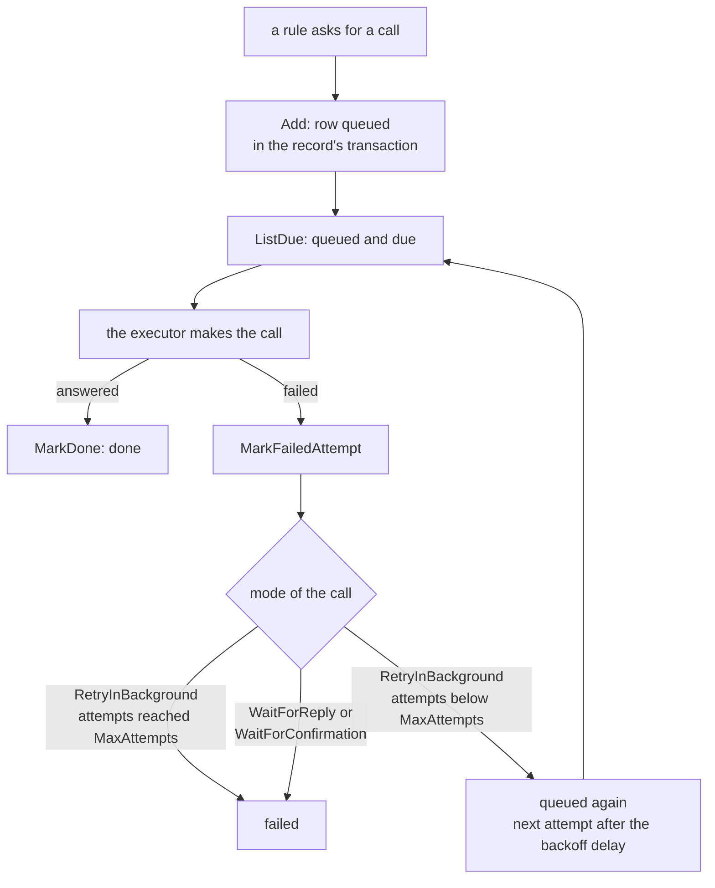

# Call Lifecycle

The life of one queued call; verified by `tests/queue_test.go`

1. A rule asks for a call.
2. The `Add` function queues the row in the record's transaction.
3. The `ListDue` function queries for queued and due calls.
4. The executor makes the call.
5. If the call is answered, `MarkDone` sets the state to done.
6. If the call fails, `MarkFailedAttempt` is called.
7. The mode of the call determines the next step.
8. For `RetryInBackground` with attempts below `MaxAttempts`, it is queued again with a next attempt after the backoff delay, going back to `ListDue`.
9. For `RetryInBackground` with attempts reaching `MaxAttempts`, it fails.
10. For `WaitForReply` or `WaitForConfirmation`, it fails immediately on failure.
