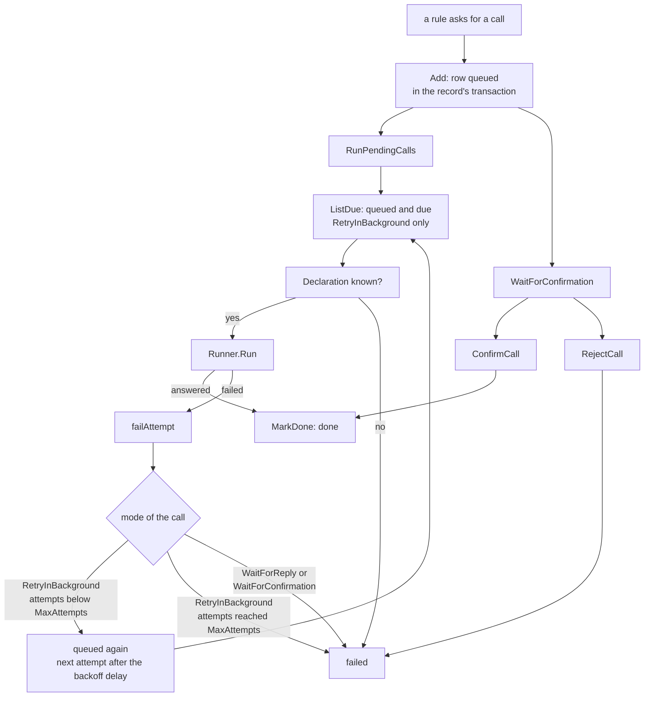

# Call Lifecycle

The life of one queued call; verified by `tests/queue_test.go` and `tests/run_test.go`

1. A rule asks for a call.
2. The `Add` function queues the row in the record's transaction.
3. `RunPendingCalls` starts processing the queue.
4. The `ListDue` function queries for queued and due calls that are `RetryInBackground` only.
5. It checks if the declaration is known. If not, the call fails.
6. If known, the executor (`Runner.Run`) makes the call.
7. If the call is answered, `MarkDone` sets the state to done.
8. If the call fails, `failAttempt` is called.
9. The mode of the call determines the next step.
10. For `RetryInBackground` with attempts below `MaxAttempts`, it is queued again with a next attempt after the backoff delay, going back to `ListDue`.
11. For `RetryInBackground` with attempts reaching `MaxAttempts`, it fails.
12. For `WaitForReply` or `WaitForConfirmation`, it fails immediately on failure.
13. If the call is a `WaitForConfirmation`, it waits.
14. `ConfirmCall` marks the `WaitForConfirmation` call as done.
15. `RejectCall` marks the `WaitForConfirmation` call as failed.
