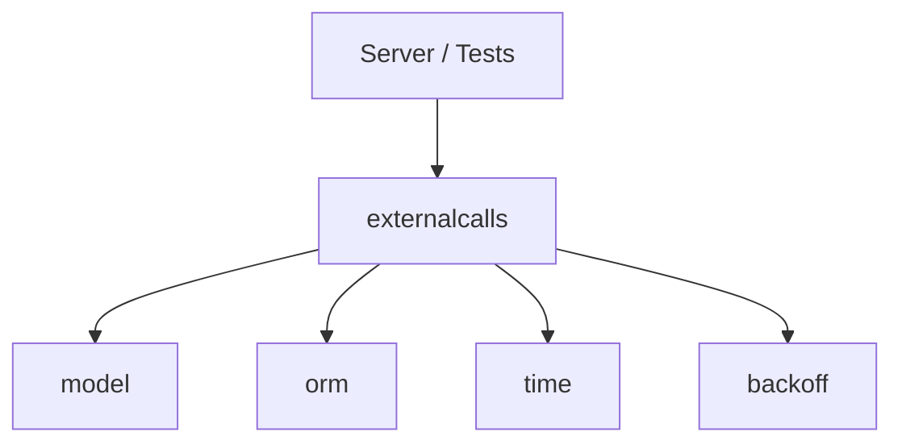

# Externalcalls Placement

`externalcalls` imports `model`, `orm`, `time`, `backoff`; nobody imports it yet (`crud` will, through the `Creator` interface, in a later plan); it runs on the server and in tests.

1. The `externalcalls` package runs on the server and in tests.
2. It imports `model` for definitions.
3. It imports `orm` for database interactions.
4. It imports `time` for nanosecond precision time.
5. It imports `backoff` for retry delays. It now also uses `time.Duration` for the retry delay.
6. Nobody imports `externalcalls` yet, but `crud` will in the future via the `Creator` interface.
